# TP4-DAR2026 : Sockets en mode non connecté UDP

**Nom Prénom** : Malak Ben Slim
**Matière** : Développement d'applications réparties, LSI 3

## Activité : Échange des datagrammes entre C/S en mode non connecté (Chat C/S avec UDP)

### Étape 1 : Préparation de l'espace de travail
J'ai créé le répertoire `Malak Ben Slim_LSI3_DevAppReparties` qui contient le projet Java `TP4-DAR2026`. La classe `ServeurUDP` (package `serverPackage`) et la classe `ClientUDP` (package `clientPackage`) sont développées à partir de l'exemple du cours « Socket en mode non connecté ».

Structure du projet :
```
TP4-DAR2026/src
├── clientPackage
│   ├── ClientUDP.java          (étape 2)
│   └── ClientChatUDP.java      (étape 3)
└── serverPackage
    ├── ServeurUDP.java         (étape 2)
    └── ServeurChatUDP.java     (étape 3)
```

### Étape 2 : Chat unidirectionnel et test avec un seul client

#### Principe
Contrairement à TCP (TP1 à TP3), UDP est un protocole **non connecté** : il n'y a ni `ServerSocket`, ni `accept()`, ni flux d'entrée/sortie. Le client et le serveur échangent des **datagrammes** (`DatagramPacket`) à travers une socket `DatagramSocket`. Chaque paquet contient les données (un tableau d'octets) et l'adresse (IP et port) du destinataire ou de l'expéditeur.

- `ServeurUDP` crée un `DatagramSocket` lié au port `1234` avec `InetSocketAddress`. Il boucle ensuite sur `receive(paquet)`, qui est bloquant : le serveur attend l'arrivée d'un datagramme.
- À chaque paquet reçu, le serveur convertit les octets en `String` avec `new String(paquet.getData(), 0, paquet.getLength())`, puis affiche l'adresse IP (`getAddress()`), le port (`getPort()`) de l'expéditeur et le message. Le traitement est unidirectionnel : le serveur ne répond pas.
- `ClientUDP` demande à l'utilisateur son nom d'utilisateur, puis crée une `DatagramSocket` sans port (le système d'exploitation attribue un port source libre) et récupère l'adresse du serveur avec `InetAddress.getByName`.
- Pour chaque ligne saisie, le client construit le message `[NomUtilisateur] : texte`, le convertit en tableau d'octets avec `getBytes()`, crée un `DatagramPacket(buffer, buffer.length, adresseServeur, port)` et l'envoie avec `send()`.
- Pour terminer, le client saisit `quit` : la boucle s'arrête et la socket est fermée.

Le serveur n'a aucune connexion à établir : il suffit qu'il écoute sur le port `1234` pour recevoir les datagrammes envoyés par n'importe quel client.

#### Lancement : le serveur d'abord
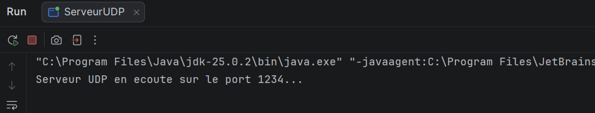
Interprétation : le serveur affiche `Serveur UDP en ecoute sur le port 1234...` et reste bloqué sur `receive()`.

### Test avec un seul client

#### Saisie du nom d'utilisateur
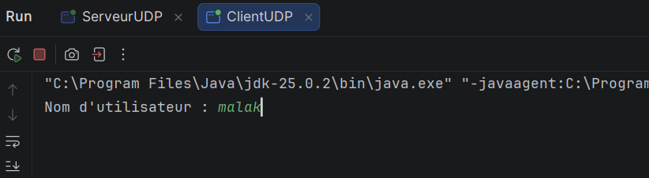
Interprétation : le client est lancé dans un deuxième onglet (`ClientUDP`). Il demande `Nom d'utilisateur :` et j'ai saisi `malak`.

#### Envoi du premier message
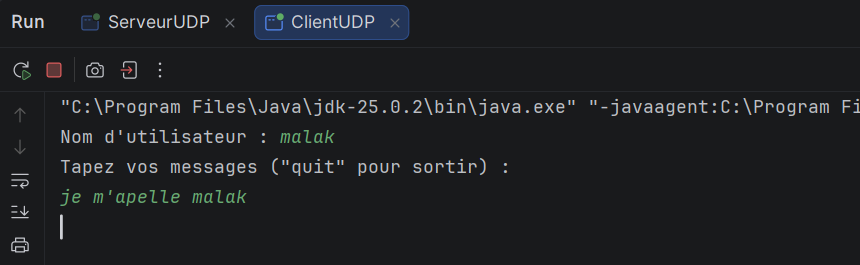
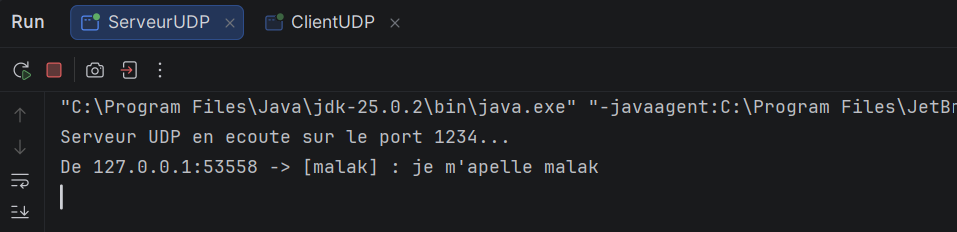
Interprétation : le client affiche `Tapez vos messages ("quit" pour sortir) :` et j'envoie `je m'apelle malak`. Le serveur affiche `De 127.0.0.1:53558 -> [malak] : je m'apelle malak`. Le message est bien préfixé par le nom d'utilisateur. L'adresse `127.0.0.1` est celle de la machine elle-même, car le client et le serveur tournent sur le même PC. Le port `53558` est le **port source** de la socket du client, attribué par le système d'exploitation.

#### Envoi d'un deuxième message
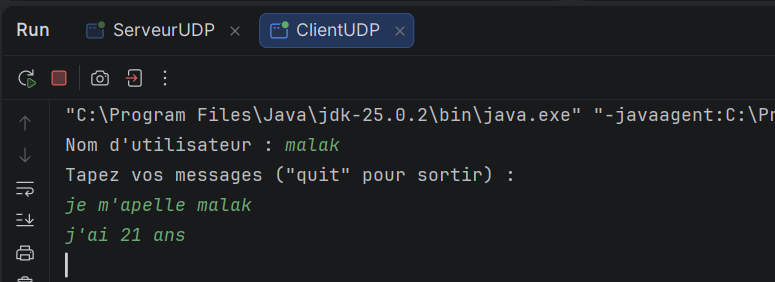
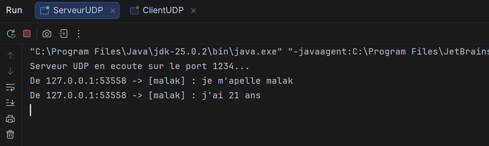
Interprétation : j'envoie `j'ai 21 ans`. Le serveur affiche un deuxième datagramme avec la même adresse `127.0.0.1:53558`. Le port reste identique pour tous les messages d'une même exécution du client, car la socket du client est créée une seule fois.

#### Fin du client
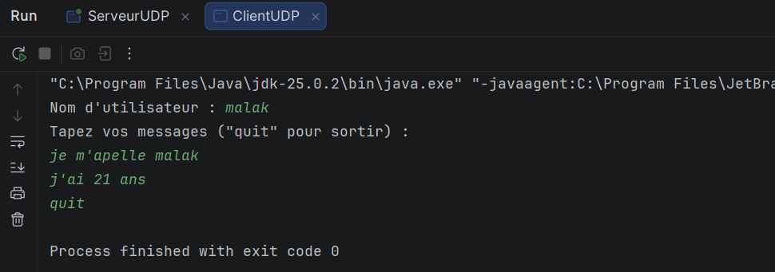
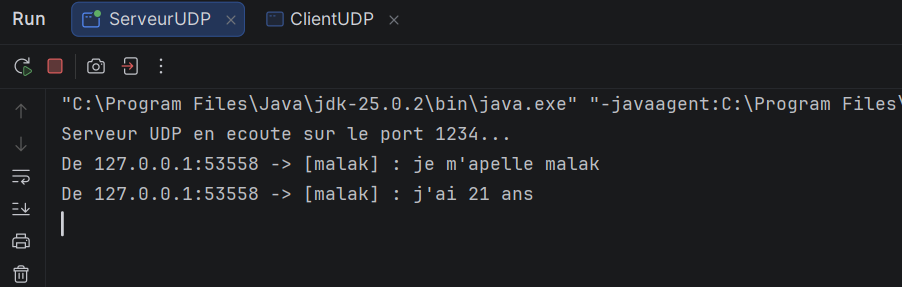
Interprétation : le client saisit `quit` et se termine avec `Process finished with exit code 0`. Le serveur n'affiche rien de plus et continue de tourner : en UDP il n'y a pas de connexion, donc le serveur n'est pas prévenu de la déconnexion du client.

### Test complémentaire avec un deuxième client
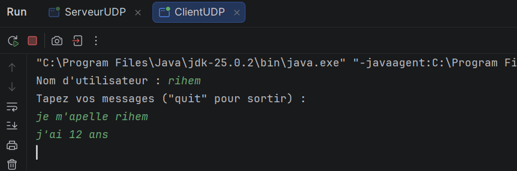
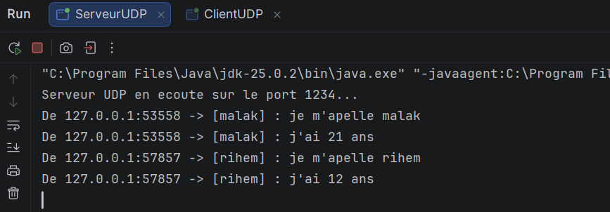
Interprétation : j'ai relancé `ClientUDP` avec le nom `rihem` et envoyé `je m'apelle rihem` puis `j'ai 12 ans`. Le serveur affiche ces messages à la suite de ceux de `malak`, avec un **port différent** (`57857` au lieu de `53558`). Les deux clients ont la même adresse IP (`127.0.0.1`), ce qui les distingue est leur port source. Le serveur reçoit donc des datagrammes de plusieurs clients sans rien avoir à faire de particulier. Il ne garde cependant aucune trace des clients et ne leur répond pas : ce sera le rôle de l'étape suivante.

### Synthèse
- UDP est un protocole **non connecté** : pas de `accept()` ni de flux, uniquement des `DatagramPacket` envoyés et reçus avec `send()` et `receive()`.
- Le serveur lie sa socket à un port connu (`1234`). Le client n'a pas besoin de port fixe : le système lui en attribue un, et le serveur le retrouve dans `paquet.getPort()`.
- Chaque datagramme contient l'adresse de l'expéditeur : le serveur peut donc afficher l'IP et le port de l'expéditeur, et pourrait lui répondre.
- L'envoi et la réception se font avec des **tableaux d'octets** : il faut convertir le texte avec `getBytes()` côté client et reconstruire la chaîne avec `new String(data, 0, length)` côté serveur.
- Il faut utiliser `paquet.getLength()` pour ne lire que les octets reçus. Sinon on afficherait tout le tampon de 1024 octets.
- Plusieurs clients peuvent écrire au même serveur : ils sont distingués par leur port source.

### Fermeture des sockets
Le client ferme sa socket avec `socket.close()` et son `Scanner` avec `sc.close()` après la boucle. Le serveur tourne dans une boucle infinie : il s'arrête quand j'arrête l'exécution dans l'IDE.

### Remarques
- Avec UDP, l'ordre de lancement n'est pas bloquant : si le client est lancé avant le serveur, il n'y a pas de `ConnectException`. Les datagrammes envoyés sont simplement perdus, car aucun serveur n'écoute encore sur le port `1234`.
- UDP ne garantit ni la **livraison**, ni l'**ordre** des datagrammes. En local, les messages arrivent correctement.
- Le tampon du serveur fait 1024 octets : un message plus long serait tronqué.
- `localhost` et le port `1234` sont écrits dans `ClientUDP`. Pour un test en réseau, il faudra remplacer `localhost` par l'adresse IP de la machine serveur.


### Étape 3 : Chat bidirectionnel et diffusion à plusieurs clients

#### Principe
À l'étape 2, le serveur se contentait d'afficher les messages. À l'étape 3, il doit **retransmettre** chaque message aux autres clients. Comme UDP est non connecté, le serveur ne sait pas qui est « connecté » : il doit donc mémoriser lui-même les adresses des clients.

**Côté serveur (`ServeurChatUDP`)**
- Le serveur garde une liste `ArrayList<SocketAddress> clients` contenant l'adresse (IP et port) de chaque client qui lui a envoyé au moins un message : c'est la « connexion » simulée.
- À chaque paquet reçu, il récupère l'adresse de l'expéditeur avec `paquet.getSocketAddress()`. Si cette adresse n'est pas déjà dans la liste, il l'ajoute.
- Il transmet ensuite le message, dans un nouveau `DatagramPacket`, à **tous les clients de la liste sauf l'expéditeur**.
  **Côté client (`ClientChatUDP`)**
- Le client doit pouvoir **envoyer et recevoir en même temps**. Or `receive()` et `nextLine()` sont tous deux bloquants : le client utilise donc **deux threads**.
- Un thread secondaire boucle sur `socket.receive()` et affiche les messages reçus des autres clients en temps réel.
- Le thread principal lit le clavier et envoie les messages au serveur, avec le même format qu'à l'étape 2 : `[NomUtilisateur] : texte`.
- Les deux threads utilisent la **même `DatagramSocket`** : le serveur répond vers le port de cette socket, c'est donc elle qui doit recevoir les messages.
- Dès son démarrage, le client envoie le message `[nom] : a rejoint le chat`. Ce premier message permet au serveur d'enregistrer le client, qui peut alors recevoir les messages des autres avant même d'avoir écrit.
- Pour sortir, le client saisit `quit` : le message est envoyé aux autres, puis la socket est fermée, ce qui arrête aussi le thread de réception.
#### Lancement du serveur
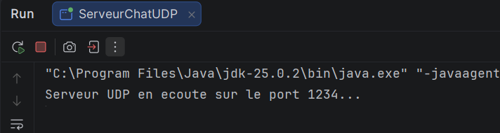
Interprétation : j'exécute `ServeurChatUDP`. Le serveur écoute sur le port `1234` et attend le premier datagramme. La liste des clients est vide.

### Test avec plusieurs clients
Dans IntelliJ, j'ai autorisé plusieurs instances de `ClientChatUDP` : chaque client apparaît dans un onglet différent à côté de `ServeurChatUDP`.

#### Premier client : malak
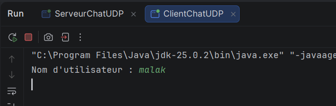
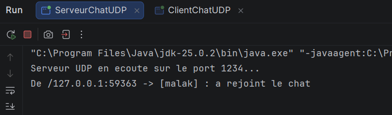
Interprétation : le client demande le nom d'utilisateur et je saisis `malak`. Le serveur reçoit immédiatement `[malak] : a rejoint le chat`, envoyé automatiquement au démarrage du client, et affiche l'adresse `127.0.0.1` suivie du port source du client. Le client est maintenant enregistré dans la liste. Il n'y a personne d'autre à qui transmettre ce message.

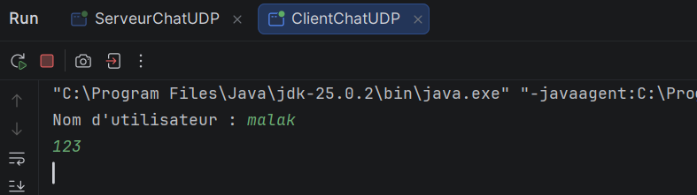
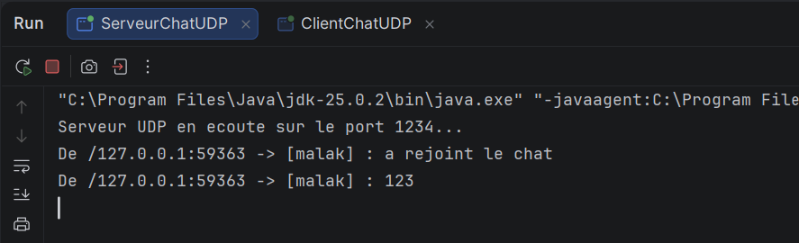
Interprétation : `malak` envoie le message `123`. Le serveur l'affiche avec la même adresse et le même port, ce qui confirme que la socket du client est la même pour tous ses messages. Aucun autre client n'est connecté : le message n'est transmis à personne.

#### Deuxième client : rihem
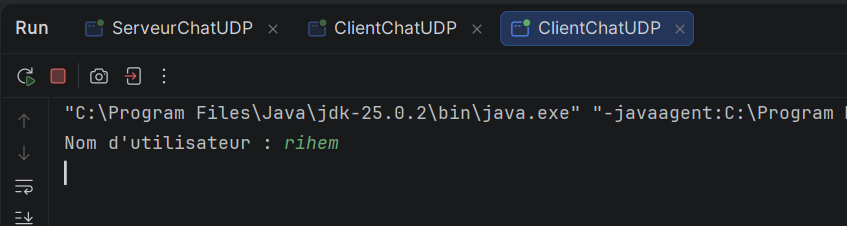
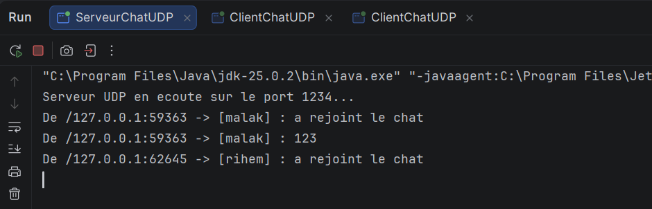
Interprétation : je lance un deuxième client avec le nom `rihem`. Le serveur affiche `[rihem] : a rejoint le chat` avec un **port différent** de celui de `malak` : les deux clients ont la même IP mais sont distingués par leur port. `rihem` est ajouté à la liste, et le serveur transmet ce message à `malak`.

#### Troisième client : mohamed
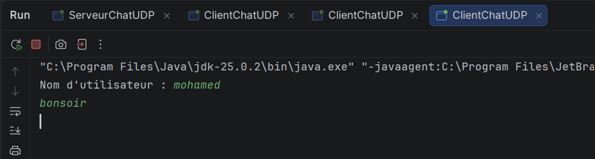
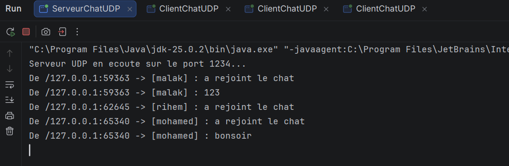
Interprétation : un troisième client `mohamed` se connecte et envoie `bonsoir`. Le serveur enregistre ses messages avec un troisième port. La liste contient maintenant trois adresses.

### Vérification de la diffusion
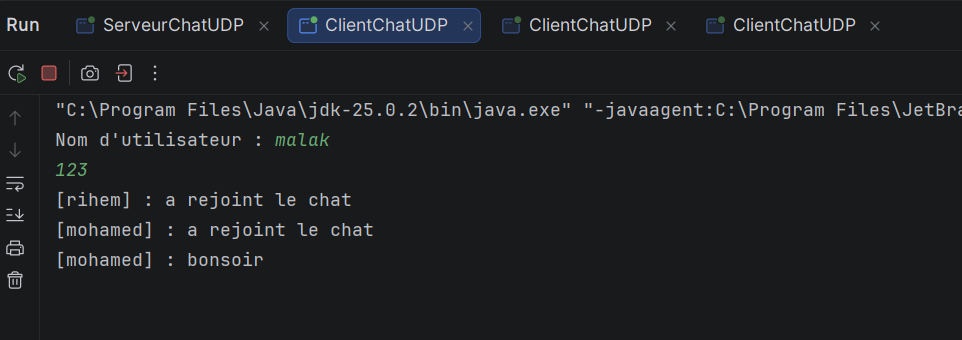
Interprétation : le client `malak` reçoit en temps réel `[rihem] : a rejoint le chat`, `[mohamed] : a rejoint le chat` et `[mohamed] : bonsoir`, sans avoir rien saisi. Cela vient du thread de réception, qui affiche les messages dès leur arrivée pendant que le thread principal attend la saisie.

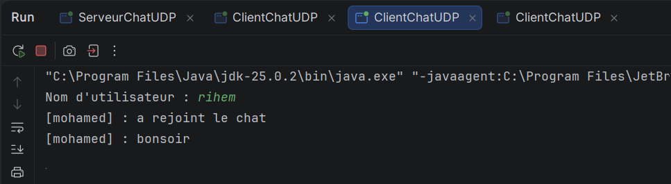
Interprétation : `rihem` reçoit les messages de `mohamed`, mais pas `[malak] : 123`. Ce message a été envoyé **avant** son arrivée : le serveur ne garde pas d'historique et ne transmet qu'aux clients déjà enregistrés. De plus, aucun client ne reçoit ses propres messages, puisque le serveur exclut l'expéditeur.

### Départ d'un client
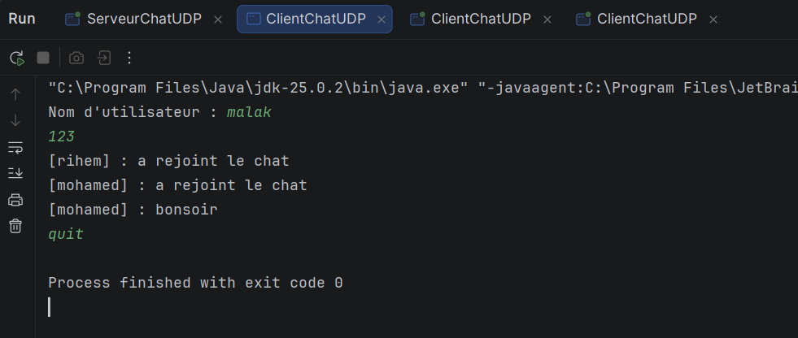
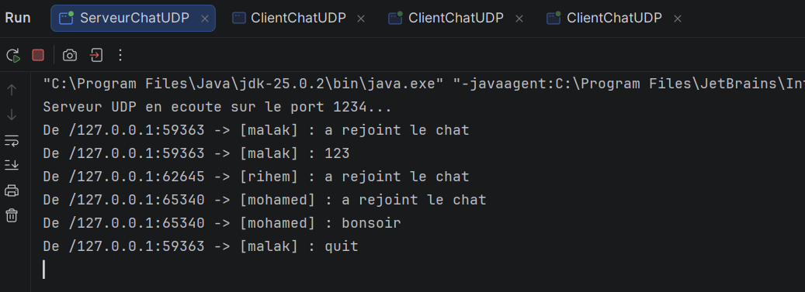
Interprétation : `malak` saisit `quit` et son programme se termine avec `Process finished with exit code 0`. Le serveur affiche `[malak] : quit` et le transmet aux autres.

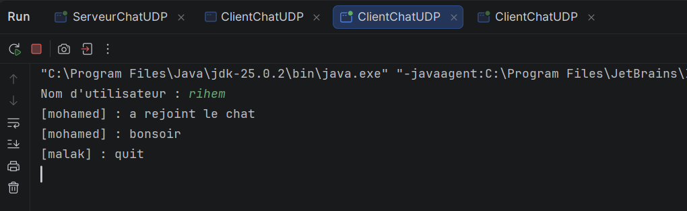
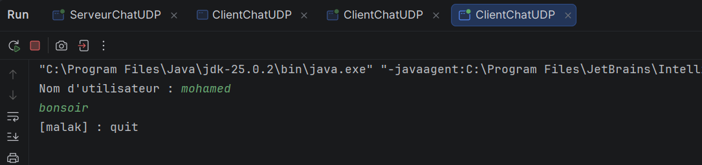
Interprétation : `rihem` et `mohamed` reçoivent `[malak] : quit` et sont donc informés du départ. Ils peuvent continuer à discuter, car le serveur tourne toujours.

### Poursuite de la discussion sans malak
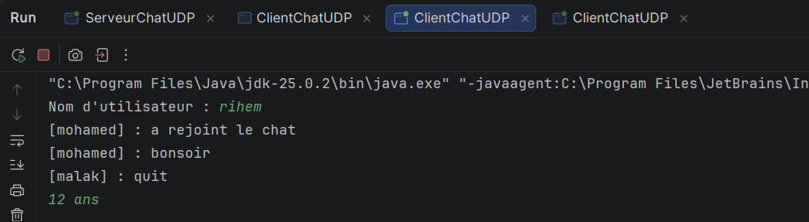
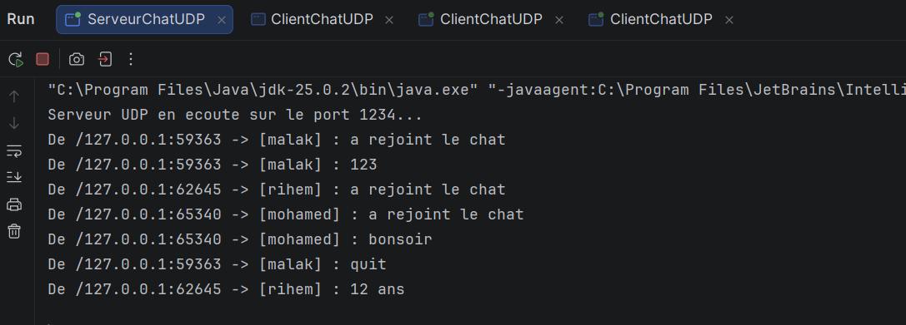
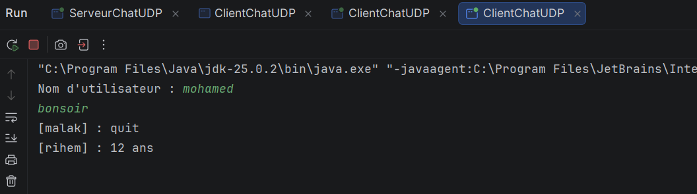
Interprétation : `rihem` envoie `12 ans`. Le serveur l'affiche et le retransmet : `mohamed` le reçoit, ce qui prouve que le chat continue à fonctionner après le départ de `malak`.

### Synthèse
- Le chat repose sur **deux idées** : le serveur mémorise les adresses des clients (liste `SocketAddress`) et il **retransmet** chaque message à tous les autres, sauf à l'expéditeur.
- En UDP, il n'y a pas de connexion : un client est « connecté » dès que le serveur a reçu un de ses datagrammes. C'est pourquoi le client envoie `a rejoint le chat` dès le démarrage.
- Le client a besoin de **deux threads** : l'un reçoit (`receive()` est bloquant), l'autre lit le clavier (`nextLine()` est bloquant). Sans ce découpage, il ne pourrait pas recevoir pendant qu'il attend une saisie.
- Les clients sont distingués par leur **adresse complète** (IP et port) : sur la même machine, l'IP est la même, mais chaque socket a un port source différent.
- L'échange se fait en **quasi temps réel** : les messages apparaissent chez les autres clients dès leur envoi.
### Remarques
- Le serveur **ne retire pas** un client qui a quitté : l'adresse de `malak` reste dans la liste, et le serveur continue de lui envoyer des datagrammes qui sont simplement perdus, sans erreur. Une amélioration serait de retirer le client de la liste quand le serveur reçoit `quit`.
- Un client ne reçoit pas les messages envoyés avant son arrivée : le serveur n'enregistre aucun historique.
- UDP ne garantit ni la livraison ni l'ordre des messages. En local, tout arrive correctement.
- Le tampon est de 1024 octets : un message plus long serait tronqué.
- `localhost` est écrit dans `ClientChatUDP`. Pour tester sur deux machines, il faut mettre l'adresse IP de la machine du serveur.
 